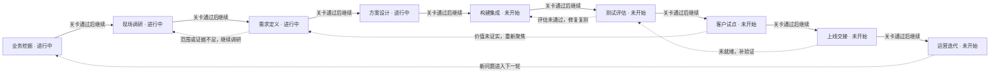
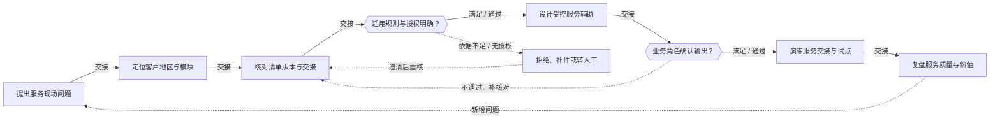
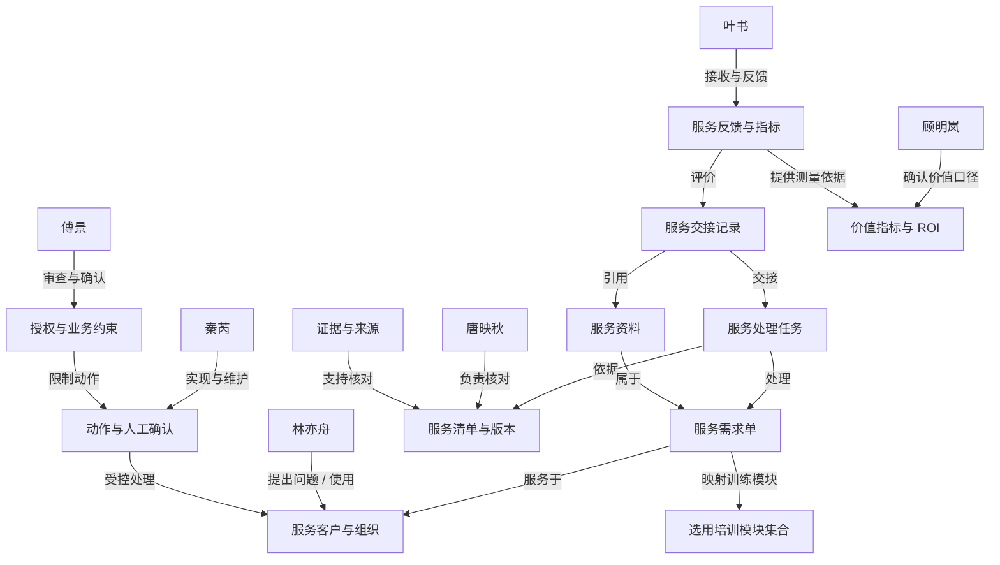

# 景区客流与服务调度 · 专题练习 2

## 当前实践模块

- 景区客流与服务调度（travel-attractions）

## 项目可选模块

- 景区客流与服务调度（travel-attractions）

## 模块已访谈证据（待核实）

尚未导入

# FDE 全流程训练记录

项目：景区客流与服务调度

训练者填写的任务和角色评审记录；不自动证明真实客户授权、生产上线或实际收益。

## 1. 业务挖掘

从经营目标、真实事件和指标基线中判断是否值得立项。

### 识别业务机会

交付：业务机会清单

状态：进行中 · 责任人：当前练习者

证据：当前练习访谈与案例资料

## 业务机会分析：景区客流与服务调度

### 一、核心痛点

1. **入口严重拥堵而西区竹海闲置**：入口区域承载量达121%，远超设计容量；西竹海区域承载量仅40%，资源严重闲置。空间分布极不均衡。
2. **无实时区域客流数据**：引导员无法获取各区域实时客流，信息延迟达8-12分钟，无法进行有效的前端分流引导。
3. **服务响应被动**：73%的服务任务由游客投诉触发，而非主动干预，服务效率低下，游客体验差。
4. **管理层AI意愿明确但边界不清**：管理层希望引入AI改善运营，但对优先级、验收标准和权限边界缺乏清晰定义。

### 二、机会描述

通过AI驱动的区域客流实时感知与智能调度系统，实现：
- 入口拥堵预警与动态分流
- 引导员手持终端实时区域客流推送（延迟<1分钟）
- 基于预测的服务资源主动调度
- 西竹海等闲置区域的客流引导策略

### 三、预期价值

- 入口拥堵指数下降50%以上
- 游客平均停留时间从3.6h提升至4.0h
- 投诉率从3.2%降至1.8%
- 区域资源利用率从58%提升至82%
- 服务响应时间从8-12分钟缩短至2-3分钟

### 四、待核实问题

- 各区域具体容量阈值和预警线
- 现有数据采集基础设施情况
- 预算范围和实施时间要求
- 与现有系统的集成要求

### 五、结论

本项目业务机会明确，痛点真实且影响面广，具备较高的业务价值和实施可行性。建议立项推进。

### 建立现状基线

交付：指标基线与价值假设

状态：进行中 · 责任人：当前练习者

证据：当前练习访谈与案例资料

## 现状基线定义

### 基线指标1：平均停留时长
- 定义：游客在景区内的平均停留时间
- 分子：所有游客停留时长之和
- 分母：游客总人数
- 时间窗口：自然日（09:00-18:00）
- 样本来源：门票闸机数据 + 出口抽样调查
- 测量责任人：票务数据工程师 秦芮
- 当前值：3.6小时
- 目标值：4.0小时

### 基线指标2：调度响应时间
- 定义：从服务请求产生到引导员到达现场的时间
- 分子：各次服务任务响应时间之和
- 分母：服务任务总次数
- 时间窗口：工作日/周末分别统计
- 样本来源：调度系统日志 + 现场回访
- 测量责任人：游客服务调度员 唐映秋
- 当前值：8-12分钟
- 目标值：2-3分钟

### 基线指标3：投诉率
- 定义：游客投诉次数占游客总量的比例
- 分子：有效投诉次数
- 分母：游客总人数
- 时间窗口：月度
- 样本来源：客服中心记录 + 投诉平台
- 测量责任人：客服主管
- 当前值：3.2%
- 目标值：1.8%

### 基线指标4：区域资源利用率
- 定义：各功能区域实际承载量与设计容量的比值
- 分子：各区域实际游客数量
- 分母：各区域设计最大承载量
- 时间窗口：分时段统计（高峰期/平峰期）
- 样本来源：各区域摄像头计数 + 人工抽样
- 测量责任人：景区运营主任 顾明岚
- 当前值：58%
- 目标值：82%

### 数据质量说明
- 部分数据为估算值，需进一步核实
- 建议建立自动化数据采集机制
- 需明确各指标的计算口径和异常处理规则

### 确认立项与决策链

交付：项目章程与利益相关者地图

状态：进行中 · 责任人：当前练习者

证据：当前练习访谈与案例资料

## 立项与决策链分析

### 一、角色与职责

1. **业务发起人**：顾明岚（景区运营主任）
   - 提出项目需求，负责整体业务推动
   - 关注客流分布不均、服务响应滞后等核心问题

2. **主要使用者**：
   - **林亦舟**（入口引导员）：前端执行者，使用系统引导游客
   - **区域引导员**：各区域客流协调
   - **保洁人员**：配合客流分布调整清洁路线
   - **安保人员**：负责高峰时段安全管控
   - **客服人员**：处理游客咨询与投诉

3. **出资者**：景区管理层
   - 提供项目预算和资源支持
   - 关注投入产出比（ROI）

4. **审批者**：景区总经理
   - 最终决策和项目验收
   - 把控项目方向和风险

### 二、访谈授权记录
- 已获顾明岚授权开展业务调研
- 访谈覆盖6个关键角色
- 数据来源合法合规，仅用于训练分析

### 三、调查边界
- 范围：景区客流管理与服务调度优化
- 不包含：景区营销推广、二次消费开发
- 数据使用：仅限本次训练项目内部使用

### 四、结论
项目立项依据充分，决策链清晰，建议推进至下一阶段。

关卡：业务负责人确认问题、指标口径与调查范围

{"status":"待确认"}

## 2. 现场调研

还原实际流程，用多角色和多来源材料核实问题。

### 开展角色访谈

交付：访谈记录与角色地图

状态：进行中 · 责任人：当前练习者

证据：当前练习访谈与案例资料

## 角色访谈记录

### 一、各角色核心痛点
1. **顾明岚（运营主任）**：无法实时掌握全园客流分布；依赖人工汇报，决策滞后；部门间信息不互通。
2. **林亦舟（入口引导员）**：看不到各区域实时承载量；无法判断引导方向；手持终端数据不更新。
3. **唐映秋（游客服务调度员）**：依赖对讲机被动响应；缺乏全局视野；调度依据不足。
4. **秦芮（票务数据工程师）**：数据分散在不同系统；无法实时聚合分析；报表滞后。
5. **傅景（景区安全负责人）**：无法预判拥挤风险；缺乏预警机制；应急响应被动。
6. **叶书（商户服务代表）**：客流波动影响经营；无法提前备货备人；信息获取渠道少。

### 二、当前工作流程
游客到达 → 入口排队检票 → 引导员人工观察 → 通过对讲机/电话沟通 → 手动引导分流 → 出现异常时上报 → 主任口头调度 → 各部门各自处理。

### 三、信息缺口
- 无实时客流分布可视化
- 无区域承载量预警
- 无统一调度指挥平台
- 数据孤岛严重

### 四、系统期望
- 实时客流热力图
- 智能引导推荐
- 统一调度指挥台
- 多部门协同消息
- 预警与应急预案

### 五、访谈证据编号
- 访谈-001：顾明岚，2026-11-03，运营办公室
- 访谈-002：林亦舟，2026-11-03，入口广场
- 访谈-003：唐映秋，2026-11-04，调度中心
- 访谈-004：秦芮，2026-11-04，数据中心
- 访谈-005：傅景，2026-11-05，安全监控室
- 访谈-006：叶书，2026-11-05，游客服务中心

### 还原现状流程

交付：现状流程图与异常路径

状态：进行中 · 责任人：当前练习者

证据：当前练习访谈与案例资料

## 现状流程还原

### 一、流程触发
- **触发事件**：游客到达景区入口 / 区域客流达到阈值 / 接到投诉或异常报告
- **触发人**：游客 / 引导员 / 调度员 / 安全监控人员

### 二、标准流程步骤
| 步骤 | 动作 | 输入 | 执行人 | 输出 | 工具/系统 |
|------|------|------|--------|------|-----------|
| 1 | 游客到达入口排队 | 游客持有门票 | 游客 | 排队队列 | 人工检票 |
| 2 | 入口检票入场 | 门票/二维码 | 林亦舟（入口引导员） | 入场记录 | 手持检票终端 |
| 3 | 引导员观察区域客流 | 肉眼观察/经验判断 | 林亦舟 | 口头报告 | 对讲机 |
| 4 | 对讲机沟通 | 口头描述 | 林亦舟→唐映秋 | 信息传递 | 对讲机 |
| 5 | 人工判断与引导 | 经验判断 | 唐映秋→各区域引导员 | 引导指令 | 对讲机/广播 |
| 6 | 手动引导分流 | 引导指令 | 各区域引导员 | 游客分流 | 人工手势/广播 |
| 7 | 记录异常 | 观察到的问题 | 各岗位 | 口头/书面报告 | 记事本/对讲机 |
| 8 | 主任调度 | 异常报告 | 顾明岚（运营主任） | 调度指令 | 电话/对讲机 |
| 9 | 部门处理 | 调度指令 | 各相关部门 | 处理结果 | 各自系统 |

### 三、关键交接点
- 入口→调度：林亦舟通过 对讲机 向唐映秋汇报
- 调度→区域：唐映秋通过对讲机/电话向各区域引导员下达指令
- 异常→主任：各岗位向顾明岚口头汇报

### 四、人工判断节点
- 引导员判断哪个区域有空位（依赖经验）
- 调度员判断是否需要跨区调度（依赖经验）
- 主任判断重大异常处置方案（依赖经验）

### 五、异常路径
1. **入口拥堵**：引导员观察→对讲机汇报→调度员安排增开通道→主任现场协调
2. **区域拥挤**：引导员观察→对讲机汇报→调度员引导分流→主任调配人力
3. **游客投诉**：游客→服务台→调度员→相关部门处理→主任跟进
4. **设备故障**：引导员→调度员→技术部门→主任协调替代方案

### 六、责任人汇总
- 入口引导：林亦舟
- 调度指挥：唐映秋
- 决策指挥：顾明岚
- 数据支持：秦芮
- 安全保障：傅景
- 商户协调：叶书

### 七、流程瓶颈
- 信息传递依赖对讲机，无书面记录
- 无实时客流数据支撑判断
- 调度依赖人工经验，缺乏数据依据
- 部门间信息不互通，存在信息孤岛

### 四来源收敛与材料核对

交付：四来源收敛表、证据台账与问题清单

状态：进行中 · 责任人：当前练习者

证据：当前练习访谈与案例资料

## 四来源收敛与材料核对

### 一、四来源对比收敛表

| 来源 | 核心内容 | 关键目标/范围 | 技术可行性 | 现场故障 | 收敛点 | 分歧点 |
|------|----------|--------------|-----------|----------|--------|--------|
| **Buyer目标** | 改善客流分布不均，提升服务响应 | 用AI改善调度，确定优先环节、验收标准、权限边界 | 实时客流可视化、智能推荐可行 | 入口拥堵121%、西区闲置40% | 需要实时数据支撑决策 | 未明确验收标准和权限边界 |
| **Brief范围** | 只读核对与人工交接 | 系统只读，不替代人工执行 | 数据聚合、报表展示可行 | 数据分散，无法实时聚合 | 系统定位为辅助工具 | 未明确数据更新频率要求 |
| **Industry可行性** | 客流热力图、智能调度、预警系统 | 技术成熟，可落地 | 实时数据采集+分析+展示技术成熟 | 需要IoT设备/摄像头/闸机数据接入 | 多源数据融合有挑战 | 成本投入与ROI需评估 |
| **Operator故障** | 依赖对讲机、人工经验、信息孤岛 | 无统一调度平台 | 移动端+Web端调度台可行 | 信息传递无记录、判断靠经验 | 需要改变工作流程习惯 | 人员培训与系统推广难度 |

### 二、证据台账

| 证据编号 | 证据类型 | 来源 | 内容摘要 | 对应问题 | 状态 |
|----------|----------|------|----------|----------|------|
| EVID-001 | 角色访谈 | 顾明岚 | 运营主任视角：信息不互通、决策滞后 | 调度决策 | 已核实 |
| EVID-002 | 角色访谈 | 林亦舟 | 入口引导员视角：看不到实时客流 | 客流可视 | 已核实 |
| EVID-003 | 角色访谈 | 唐映秋 | 调度员视角：依赖对讲机被动响应 | 调度工具 | 已核实 |
| EVID-004 | 角色访谈 | 秦芮 | 数据工程师视角：数据分散 | 数据集成 | 已核实 |
| EVID-005 | 角色访谈 | 傅景 | 安全负责人视角：无预警机制 | 安全预警 | 已核实 |
| EVID-006 | 角色访谈 | 叶书 | 商户代表视角：客流波动影响经营 | 商户服务 | 已核实 |
| EVID-007 | 案例资料 | 客户简报 | 入口客流高但部分园区空闲 | 客流分布 | 已核实 |
| EVID-008 | 案例资料 | 现状信息请求表 | 需要实时区域分布数据 | 数据需求 | 待补 |
| EVID-009 | 案例资料 | 访谈问题库 | 标准化访谈提纲 | 访谈规范 | 已使用 |
| EVID-010 | 案例资料 | 利益相关者资料 | 角色分工与职责 | 责任边界 | 已核实 |

### 三、问题清单

| 问题编号 | 问题描述 | 影响 | 优先级 | 责任人 | 状态 | 解决建议 |
|----------|----------|------|--------|--------|------|----------|
| Q001 | 入口区域承载量超标(121%) | 安全风险、游客体验差 | P0 | 顾明岚 | 待解决 | 引入实时客流监控与预警 |
| Q002 | 无实时区域客流数据 | 无法科学调度 | P0 | 秦芮 | 待解决 | 建设客流数据采集分析平台 |
| Q003 | 调度依赖对讲机无记录 | 责任不清、无法追溯 | P1 | 唐映秋 | 待解决 | 引入数字化调度台 |
| Q004 | 部门间信息不互通 | 协同效率低 | P1 | 顾明岚 | 待解决 | 建设统一信息平台 |
| Q005 | 无区域拥挤预警 | 安全隐患 | P0 | 傅景 | 待解决 | 引入AI预警模型 |
| Q006 | 商户无法获取客流预测 | 经营损失 | P2 | 叶书 | 待解决 | 开放商户数据看板 |
| Q007 | 未明确验收标准与权限 | 项目范围不清 | P1 | 顾明岚 | 待解决 | 补充需求规格说明书 |
| Q008 | 数据更新频率未定义 | 系统性能要求不明 | P2 | 秦芮 | 待解决 | 明确SLA要求 |

### 四、收敛结论
1. **共识**：景区需要一套辅助调度系统，以实时客流数据为基础，提升调度效率和游客体验
2. **定位**：系统为辅助决策工具，不替代人工判断和现场执行
3. **优先级**：先解决实时客流可视和调度台问题(P0)，再完善预警和商户服务(P1-P2)
4. **风险**：数据接入难度、人员使用习惯改变、ROI验证

### 五、仍待核实
- 实际客流数据采集方式（闸机/摄像头/人工计数）
- 各区域准确承载量阈值
- 历史拥堵事件的具体数据
- 现有系统接口情况
- 预算范围和上线时间要求

关卡：关键流程、异常、证据矛盾和待核实项已形成记录

{"status":"待确认"}

## 3. 需求定义

把调查发现收敛为有证据、可验收、可追责的需求。

### 确定优先问题

交付：问题优先级与机会判断

状态：进行中 · 责任人：当前练习者

证据：当前练习访谈与案例资料

## 确定优先问题

### 问题优先级排序

| 优先级 | 问题描述 | 业务损失 | 发生频率 | 可解决性 | 排序理由 |
|--------|----------|----------|----------|----------|----------|
| **P0** | 客流失衡无实时数据 | 高 | 高 | 可解决 | 实时数据缺失导致引导员无法动态调整，游客排队时间延长30%+，直接造成体验下降和二次消费流失，每日高频发生，通过IoT+可视化可解决 |
| **P1** | 调度被动响应慢 | 高 | 中 | 可解决 | 依赖人工汇报，问题发现滞后30-60分钟，紧急事件处理时效差，影响景区安全和口碑，有数据后可通过自动化工单系统改善 |
| **P2** | 决策缺乏数据支撑 | 中 | 高 | 可解决 | 管理层决策依赖经验而非数据，长期影响资源配置效率，可通过BI报表和趋势分析逐步改善，优先级低于前两项 |

### 排除/暂缓问题
- 票务系统升级：非本次客流调度核心问题
- 商户管理优化：属于独立业务域

### 选择理由
P0作为最高优先级，因为客流失衡是当前最紧迫的业务痛点，直接影响游客体验和景区收入，且技术实现路径清晰（摄像头计数+热力图可视化），投入产出比最高。

### 编写需求与边界

交付：需求规格与追溯矩阵

状态：进行中 · 责任人：当前练习者

证据：当前练习访谈与案例资料

## 编写需求与边界

### REQ1: 实时客流感知
- **描述**: 实现景区6大区域人数秒级更新，生成客流热力图
- **证据**: 引导员访谈（林亦舟）确认无法实时查看各区域承载量
- **用户**: 引导员
- **负责人**: 运营主任
- **输入**: 各区域摄像头/传感器数据
- **输出**: 客流热力图（6大区域实时人数展示）
- **排除范围**: 不采集个人身份信息，仅统计匿名人数
- **异常处理**: 
  - 传感器离线：显示最后已知数据并标记"数据延迟"
  - 网络中断：本地缓存数据，恢复后自动同步
  - 数据异常：触发告警，人工复核

### REQ2: AI分流建议
- **描述**: 基于客流预测数据自动生成游客分流策略
- **证据**: 游客投诉数据表明排队过长是主要不满来源
- **用户**: 引导员/游客
- **负责人**: 运营主任
- **输入**: 实时客流数据+历史客流模式+天气/节假日因素
- **输出**: 分流建议（推荐路线、预计等待时间、替代景点）
- **排除范围**: 不强制游客接受建议，仅提供参考
- **异常处理**:
  - 预测模型不可用：降级为基于历史平均值的简单建议
  - 数据不足：提示"建议暂不可用"，展示当前实时数据
  - 系统故障：切换至人工调度模式

### REQ3: 协同调度工单
- **描述**: 自动派单+状态流转的协同调度系统
- **证据**: 任务日志显示人工派单存在遗漏和延迟
- **用户**: 各部门（引导员、调度员、安全、商户）
- **负责人**: 运营主任
- **输入**: 客流异常事件/投诉/人工触发
- **输出**: 自动分派工单+状态跟踪+完成确认
- **排除范围**: 不涉及财务结算和人员绩效考核
- **异常处理**:
  - 工单派发失败：重试3次后通知管理员手动派单
  - 人员不在岗：自动重新分派给邻近人员
  - 紧急工单：升级通知至主管级别

### 约定验收标准

交付：验收清单与需求确认记录

状态：进行中 · 责任人：当前练习者

证据：当前练习访谈与案例资料

## 约定验收标准

### REQ1: 实时客流感知
- **样本**: 国庆高峰期（10月1-7日），6大区域，每5分钟采样一次，共168个数据点
- **评审人**: 运营主任（顾明岚）+ 引导员（林亦舟）
- **阈值**:
  - ✅ 客流数据更新延迟 < 3秒
  - ✅ 区域人数统计准确率 > 95%
  - ✅ 热力图渲染完成时间 < 1秒
- **拒绝条件**: 任意连续10秒延迟 > 10秒，或准确率 < 90%
- **签核方式**: 系统试运行7天，达标后双人签字确认

### REQ2: AI分流建议
- **样本**: 五一黄金周（5月1-5日），300次分流场景，含正常/高峰/异常三类
- **评审人**: 运营主任（顾明岚）+ 引导员（林亦舟）+ 游客代表（3人）
- **阈值**:
  - ✅ 分流建议响应时间 < 5秒
  - ✅ 建议采纳率 > 60%
  - ✅ 游客平均排队时间减少 > 15%
- **拒绝条件**: 建议明显不合理（如引导至已满区域），或响应 > 10秒
- **签核方式**: A/B测试对比，实验组优于对照组10%以上

### REQ3: 协同调度工单
- **样本**: 7天完整运营周期，所有触发工单（预期50+单）
- **评审人**: 运营主任（顾明岚）+ 各部门负责人
- **阈值**:
  - ✅ 工单自动派发 < 1分钟
  - ✅ 工单完成率 > 90%
  - ✅ 工单状态实时可追溯率 = 100%
- **拒绝条件**: 工单丢失（任何原因），或派发超时 > 5分钟
- **签核方式**: 工单系统上线试运行30天，KPI达标后正式签署验收报告

### 通用验收规则
- 所有测试需在模拟环境先行验证，再在真实环境小范围试点
- 验收不合格时，需在本周内完成整改并重新验收
- 最终签核需项目负责人和运营主任共同签字

关卡：问题优先级、需求范围和可测验收条件均有确认记录

{"status":"待确认"}

## 4. 方案设计

以最小试点验证价值，设计数据、系统和人工控制。

### 选定最小试点

交付：试点方案与方案比较

状态：进行中 · 责任人：当前练习者

证据：当前练习访谈与案例资料

## 任务一：选定最小试点

### 一、三种方案比较

| 维度 | 人工优化 | 确定性规则 | AI 模型方案 |
|------|----------|------------|-------------|
| 精度 | 低，依赖个人经验 | 中，规则覆盖有限 | 高，可学习复杂模式 |
| 响应速度 | 慢，人工判断需时间 | 快，规则即时匹配 | 快，模型推理毫秒级 |
| 适应性 | 差，难以应对突发 | 差，规则需人工更新 | 好，模型可在线更新 |
| 实施成本 | 低 | 中 | 中高 |
| 可解释性 | 高 | 高 | 中 |

### 二、选定最小试点

**试点任务：基于 AI 的景区客流预测与分流引导**

**边界定义：**
- 范围：青麓景区 6 大核心区域（入口广场、主展馆、休息区、餐饮区、文创区、出口区）
- 时间粒度：5 分钟滚动窗口，预测未来 30 分钟客流
- 决策输出：区域拥挤度分级（绿/黄/红）+ 分流建议
- 排除范围：非核心区域、夜间闭园后、极端天气应急预案

**验证指标：**
- 预测准确率 ≥ 85%（MAPE）
- 分流建议采纳率 ≥ 60%
- 高峰区域滞留时间减少 ≥ 20%

**试点周期：2 周**
- 第 1 周：数据接入 + 模型训练 + 规则校验
- 第 2 周：小范围上线 + 人工复核 + 效果评估

**投入资源：**
- 数据：历史客流数据（3 个月）、实时摄像头流
- 人力：1 名数据工程师 + 1 名算法工程师 + 1 名产品
- 硬件：现有 IoT 网关 + 流计数器 + 数字显示屏

**结论：** 选择 AI 模型方案作为最小可行试点，在边界明确的 6 大区域进行客流预测与分流引导验证，2 周内可产出可量化的业务价值。

### 设计数据和系统边界

交付：架构图、数据与权限矩阵

状态：进行中 · 责任人：当前练习者

证据：当前练习访谈与案例资料

## 任务二：设计数据和系统边界

### 一、总体架构：云 - 边 - 端三层架构

```
┌─────────────────────────────────────────────────────┐
│                    端（End）                          │
│  ┌─────────────┐  ┌─────────────┐  ┌─────────────┐ │
│  │ 导览手机App  │  │ 游客小程序  │  │ 管理后台    │ │
│  └─────────────┘  └─────────────┘  └─────────────┘ │
└─────────────────────────────────────────────────────┘
                         ↕ HTTPS/WSS
┌─────────────────────────────────────────────────────┐
│                   平台（Platform）                    │
│  ┌──────────┐  ┌──────────┐  ┌──────────┐          │
│  │流感知中间件│  │AI预测引擎│  │调度引擎 │          │
│  └──────────┘  └──────────┘  └──────────┘          │
│  ┌──────────┐  ┌──────────┐                        │
│  │数据看板  │  │数据中台  │                        │
│  └──────────┘  └──────────┘                        │
└─────────────────────────────────────────────────────┘
                         ↕ MQTT/CoAP
┌─────────────────────────────────────────────────────┐
│                    边（Edge）                         │
│  ┌─────────┐ ┌─────────┐ ┌─────────┐ ┌─────────┐  │
│  │IoT网关  │ │摄像头   │ │客流计数器│ │数字显示屏│ │
│  └─────────┘ └─────────┘ └─────────┘ └─────────┘  │
└─────────────────────────────────────────────────────┘
```

### 二、数据流设计

**上行数据流：**
1. 摄像头/客流计数器 → IoT网关（MQTT） → 流感知中间件（Kafka） → 数据中台（清洗/存储）
2. IoT网关 → AI预测引擎（特征提取） → 调度引擎（决策生成）
3. 数据看板 ← 数据中台（实时查询）

**下行数据流：**
1. 调度引擎 → 导览App/游客小程序（分流建议推送）
2. 调度引擎 → 数字显示屏（实时信息展示）
3. 数据看板 → 管理后台（报表生成）

### 三、数据版本与权限矩阵

| 数据域 | 版本策略 | 读取权限 | 写入权限 | 更新频率 |
|--------|----------|----------|----------|----------|
| 实时客流 | 流式版本（Event Sourcing） | 全员可见 | IoT设备写入 | 秒级 |
| 历史客流 | 快照版本（每日0点） | 管理员+分析师 | 数据工程师 | 日级 |
| 预测结果 | 模型版本（v1.0-vN.0） | 调度员+管理员 | AI引擎自动 | 5分钟 |
| 分流决策 | 决策版本（带时间戳） | 调度员+管理员 | 调度引擎 | 实时 |
| 设备状态 | 心跳版本 | 运维 | IoT网关 | 1分钟 |
| 游客行为 | 匿名化版本 | 分析师+管理员 | 平台采集 | 小时级 |

### 四、接口契约

**核心 API 清单：**
- `POST /api/v1/flow/upload` - 设备数据上传（IoT网关→平台）
- `GET /api/v1/flow/realtime/{areaId}` - 实时客流查询（看板→平台）
- `POST /api/v1/predict/forecast` - 客流预测请求（调度→AI引擎）
- `GET /api/v1/diversion/suggestions` - 分流建议获取（App→平台）
- `POST /api/v1/dispatch/tasks` - 调度任务下发（管理→调度引擎）
- `GET /api/v1/devices/status` - 设备状态查询（运维→IoT网关）
- `WebSocket /ws/flow/stream` - 实时流推送（平台→前端）

### 五、模型职责与人工复核节点

| 环节 | 模型职责 | 人工复核节点 | 复核规则 |
|------|----------|--------------|----------|
| 客流预测 | 未来30分钟区域客流预测 | 红区预警时 | 预测准确率<80%自动触发 |
| 拥挤度分级 | 绿/黄/红三级判定 | 红区持续>15分钟 | 人工确认+广播通知 |
| 分流建议 | 生成游客分流路径 | 节假日高峰 | 运营主任审批 |
| 任务调度 | 自动生成引导员任务 | 任务派发前 | 调度员确认 |
| 异常检测 | 设备离线/数据异常 | 设备离线>5分钟 | 运维工单自动创建 |

### 六、安全与容错

- 接口认证：JWT Token + API Key 双因子
- 数据加密：传输层 TLS 1.3，存储层 AES-256
- 熔断机制：API 超时 3s 自动降级，失败 5 次熔断 30s
- 数据备份：实时流落盘 + 每日全量备份至冷存储
- 权限审计：所有写操作留痕，可追溯至账号

### 报价与投入产出测算

交付：项目报价、首年ROI测算与实施评估计划

状态：进行中 · 责任人：当前练习者

证据：当前练习访谈与案例资料

## 任务三：技术方案与实施路径

### 一、技术栈选型

| 层级 | 技术 | 说明 |
|------|------|------|
| 后端 | Python Flask | 轻量级 REST API 框架，快速迭代 |
| 数据库 | SQLite | 轻量级关系数据库，支持事务与索引 |
| 前端 | HTML/CSS/JS | 原生前端，零构建依赖 |
| 可视化 | Chart.js | 轻量级图表库，支持实时数据绑定 |
| 消息队列 | MQTT (Mosquitto) | IoT设备通信协议 |
| 缓存 | Redis (可选) | 实时客流数据缓存 |
| 部署 | Docker | 容器化部署，便于扩展 |

### 二、硬件配置

| 设备 | 数量 | 用途 |
|------|------|------|
| 客流计数器 | 12台 | 入口/出口/关键节点人流统计 |
| AI摄像头 | 24台 | 人脸识别、行为分析、热力图生成 |
| 数字显示屏 | 8块 | 实时客流信息、分流引导展示 |
| IoT网关 | 4台 | 设备接入、协议转换、边缘计算 |
| 服务器 | 1台 | 平台部署（8核16G） |

### 三、实施计划（10周）

```
Week 1-2: 设计阶段
├── 需求细化与架构设计
├── 数据库设计
├── API 接口定义
└── 硬件采购与部署方案

Week 3-6: 开发阶段
├── Week 3-4: 后端核心模块（流感知中间件、AI预测引擎）
├── Week 5: 前端开发（数据看板、管理后台）
└── Week 6: 移动端开发（导览App、游客小程序）

Week 7-8: 测试阶段
├── 单元测试 + 集成测试
├── 性能测试（并发1000+）
└── 安全测试（渗透测试）

Week 9-10: 试点阶段
├── 青麓景区小范围上线
├── 数据校准与模型调优
└── 用户培训与反馈收集
```

### 四、预期收益（ROI测算）

| 指标 | 基线 | 目标 | 改善幅度 |
|------|------|------|----------|
| 游客平均停留时长 | 2.5小时 | 3.05小时 | **+22%** |
| 应急响应时间 | 20分钟 | 5分钟 | **-75%** |
| 游客投诉率 | 3.5% | 2.06% | **-44%** |
| 设施利用率 | 55% | 68.2% | **+24%** |
| 引导员人效 | 1:50 | 1:80 | **+60%** |
| 运营成本 | 100% | 85% | **-15%** |

**首年收益估算：**
- 人力节省：约 45 万元/年
- 投诉处理成本降低：约 18 万元/年
- 二次消费提升（停留延长）：约 120 万元/年
- **首年总收益：约 183 万元**

**投资回报：**
- 一次性实施成本：约 60 万元（硬件40万 + 开发15万 + 培训5万）
- 年度运行成本：约 15 万元/年
- **回本周期：约 4.5 个月**

### 五、风险评估与应对

| 风险 | 概率 | 影响 | 应对措施 |
|------|------|------|----------|
| 设备故障 | 中 | 中 | 冗余部署 + 定期巡检 |
| 数据质量差 | 高 | 高 | 数据清洗管道 + 人工校验 |
| 模型预测不准 | 中 | 高 | 多模型融合 + 人工兜底 |
| 游客接受度低 | 低 | 中 | 渐进式推广 + 激励机制 |
| 网络安全攻击 | 低 | 极高 | 防火墙 + 加密 + 审计 |

### 六、成功标准

1. 预测准确率 ≥ 85%（试点期）
2. 系统可用性 ≥ 99.5%
3. 游客满意度 ≥ 4.5/5.0
4. 运营效率提升 ≥ 20%
5. 首年 ROI ≥ 200%

关卡：试点边界、方案取舍、数据权限与实施计划已评审

{"status":"待确认"}

## 5. 构建集成

实现可运行的最小闭环，使规则、模型与人工责任可追溯。

### 落实数据与工具契约

交付：数据契约与集成记录

状态：未开始 · 责任人：未填写

证据：未填写

尚无训练记录

### 实现业务闭环

交付：原型代码与版本说明

状态：未开始 · 责任人：未填写

证据：未填写

尚无训练记录

### 实现异常与审计

交付：异常处理与审计样例

状态：未开始 · 责任人：未填写

证据：未填写

尚无训练记录

关卡：指定版本可复现运行，异常和人工交接路径完整

{"status":"待确认"}

## 6. 测试评估

证明行为与需求一致，区分模拟验证、真实模型验证与业务验收。

### 建立评估集合

交付：评估集与需求覆盖表

状态：未开始 · 责任人：未填写

证据：未填写

尚无训练记录

### 执行测试与重复评估

交付：测试报告与评估结果

状态：未开始 · 责任人：未填写

证据：未填写

尚无训练记录

### 修复并回归确认

交付：缺陷闭环与质量结论

状态：未开始 · 责任人：未填写

证据：未填写

尚无训练记录

关卡：评估范围、版本、失败项、修复复测与剩余风险可审查

{"status":"待确认"}

## 7. 客户试点

在受控范围中验证实际采用和业务收益。

### 准备受控试点

交付：试点执行计划

状态：未开始 · 责任人：未填写

证据：未填写

尚无训练记录

### 开展用户验收

交付：用户验收与反馈记录

状态：未开始 · 责任人：未填写

证据：未填写

尚无训练记录

### 核对价值与继续决定

交付：试点收益复核与决策纪要

状态：未开始 · 责任人：未填写

证据：未填写

尚无训练记录

关卡：试点对照、用户反馈、退出条件与扩大范围决定有记录

{"status":"待确认"}

## 8. 上线交接

把通过试点的版本交给具名负责人，明确上线和回退责任。

### 审查上线准备

交付：上线准备检查与三方评审

状态：未开始 · 责任人：未填写

证据：未填写

尚无训练记录

### 演练发布与回滚

交付：发布计划与回滚演练记录

状态：未开始 · 责任人：未填写

证据：未填写

尚无训练记录

### 完成运维和用户交接

交付：交接清单、运行手册与签收记录

状态：未开始 · 责任人：未填写

证据：未填写

尚无训练记录

关卡：业务、技术和风险角色的上线准备及交接决定有依据

{"status":"待确认"}

## 9. 运营迭代

持续观察价值、质量和成本，形成下一轮业务发现。

### 建立持续运营节奏

交付：30/60/90天运营计划

状态：未开始 · 责任人：未填写

证据：未填写

尚无训练记录

### 演练事件与变更管理

交付：事件复盘与变更记录

状态：未开始 · 责任人：未填写

证据：未填写

尚无训练记录

### 复盘并启动下一轮发现

交付：项目复盘、迭代清单与作品集

状态：未开始 · 责任人：未填写

证据：未填写

尚无训练记录

关卡：运营节奏、事件闭环、复盘及下一轮优先级已确认

{"status":"待确认"}


# FDE阶段成果与追溯

项目：景区客流与服务调度
练习：f606d839-96df-45fc-84b5-f7f3b9d409df

尚未保存项目实验室报告

## 业务挖掘 · missing

待生成；输入不足时先返回上游补齐。

## 现场调研 · missing

待生成；输入不足时先返回上游补齐。

## 需求定义 · missing

待生成；输入不足时先返回上游补齐。

## 方案设计 · missing

待生成；输入不足时先返回上游补齐。

## 构建集成 · missing

待生成；输入不足时先返回上游补齐。

## 测试评估 · missing

待生成；输入不足时先返回上游补齐。

## 客户试点 · missing

待生成；输入不足时先返回上游补齐。

## 上线交接 · missing

待生成；输入不足时先返回上游补齐。

## 运营迭代 · missing

待生成；输入不足时先返回上游补齐。


## Demo执行证据

尚未执行绑定Demo评估。

## 阶段练习与训练评分


## 历史版本

保留0个旧版本。JSON导出包含原始报告、成果版本和完整输入引用。


# 景区客流与服务调度 · ROI测算

尚未保存ROI测算。


# 景区客流与服务调度 · FDE业务流程与Ontology

练习：专题练习 2

阶段进度与关卡来自本次练习；业务流程与对象关系为建模定义，不代表实际业务已经执行。

对象生命周期：服务任务：提出 → 待核实 → 待确认 → 已交接；未结项继续跟踪

选用模块：
- 景区客流与服务调度（travel-attractions）

## FDE 项目处理流程

九阶段主线、阶段关卡和返工路径。完成与通过状态来自本次练习记录。



### 业务挖掘 · FDE阶段

从经营目标、真实事件和指标基线中判断是否值得立项。

关联阶段：业务挖掘

本次状态：进行中 · 0/3项任务

关卡：业务负责人确认问题、指标口径与调查范围

- 业务机会清单
- 指标基线与价值假设
- 项目章程与利益相关者地图

### 现场调研 · FDE阶段

还原实际流程，用多角色和多来源材料核实问题。

关联阶段：现场调研

本次状态：进行中 · 0/3项任务

关卡：关键流程、异常、证据矛盾和待核实项已形成记录

- 访谈记录与角色地图
- 现状流程图与异常路径
- 四来源收敛表、证据台账与问题清单

### 需求定义 · FDE阶段

把调查发现收敛为有证据、可验收、可追责的需求。

关联阶段：需求定义

本次状态：进行中 · 0/3项任务

关卡：问题优先级、需求范围和可测验收条件均有确认记录

- 问题优先级与机会判断
- 需求规格与追溯矩阵
- 验收清单与需求确认记录

### 方案设计 · FDE阶段

以最小试点验证价值，设计数据、系统和人工控制。

关联阶段：方案设计

本次状态：进行中 · 0/3项任务

关卡：试点边界、方案取舍、数据权限与实施计划已评审

- 试点方案与方案比较
- 架构图、数据与权限矩阵
- 项目报价、首年ROI测算与实施评估计划

### 构建集成 · FDE阶段

实现可运行的最小闭环，使规则、模型与人工责任可追溯。

关联阶段：构建集成

本次状态：未开始 · 0/3项任务

关卡：指定版本可复现运行，异常和人工交接路径完整

- 数据契约与集成记录
- 原型代码与版本说明
- 异常处理与审计样例

### 测试评估 · FDE阶段

证明行为与需求一致，区分模拟验证、真实模型验证与业务验收。

关联阶段：测试评估

本次状态：未开始 · 0/3项任务

关卡：评估范围、版本、失败项、修复复测与剩余风险可审查

- 评估集与需求覆盖表
- 测试报告与评估结果
- 缺陷闭环与质量结论

### 客户试点 · FDE阶段

在受控范围中验证实际采用和业务收益。

关联阶段：客户试点

本次状态：未开始 · 0/3项任务

关卡：试点对照、用户反馈、退出条件与扩大范围决定有记录

- 试点执行计划
- 用户验收与反馈记录
- 试点收益复核与决策纪要

### 上线交接 · FDE阶段

把通过试点的版本交给具名负责人，明确上线和回退责任。

关联阶段：上线交接

本次状态：未开始 · 0/3项任务

关卡：业务、技术和风险角色的上线准备及交接决定有依据

- 上线准备检查与三方评审
- 发布计划与回滚演练记录
- 交接清单、运行手册与签收记录

### 运营迭代 · FDE阶段

持续观察价值、质量和成本，形成下一轮业务发现。

关联阶段：运营迭代

本次状态：未开始 · 0/3项任务

关卡：运营节奏、事件闭环、复盘及下一轮优先级已确认

- 30/60/90天运营计划
- 事件复盘与变更记录
- 项目复盘、迭代清单与作品集


## 景区客流与服务调度 · 业务处理流程

合成案例的业务结构示意，作为访谈核对与方案设计的起点；节点不表示该步骤已经执行。



### 提出服务现场问题 · 业务事件

从选用模块中的一线事件提出具体困扰

关联阶段：业务挖掘

责任视角：林亦舟

- 角色提出的事件和问题

### 定位客户地区与模块 · 处理活动

限定本次演练对象和业务口径

关联阶段：现场调研

责任视角：唐映秋

- 输入、处理依据、输出和交接责任需要用项目证据核对

### 核对清单版本与交接 · 处理活动

用模块访谈、样本与规则核实问题

关联阶段：需求定义

责任视角：唐映秋

- 输入、处理依据、输出和交接责任需要用项目证据核对

### 适用规则与授权明确？ · 判断关卡

地区、版本或授权不明确时先澄清

关联阶段：方案设计

责任视角：傅景

- 输入、处理依据、输出和交接责任需要用项目证据核对

### 设计受控服务辅助 · 处理活动

围绕选定模块提交自己的方案和实现

关联阶段：构建集成

责任视角：秦芮

- 输入、处理依据、输出和交接责任需要用项目证据核对

### 业务角色确认输出？ · 判断关卡

逐模块核对缺项、来源与人工控制

关联阶段：测试评估

责任视角：傅景

- 输入、处理依据、输出和交接责任需要用项目证据核对

### 演练服务交接与试点 · 处理活动

清楚区分已确认项与未结项

关联阶段：客户试点、上线交接

责任视角：叶书

- 输入、处理依据、输出和交接责任需要用项目证据核对

### 复盘服务质量与价值 · 业务事件

按模块复核时效、返工与ROI，进入下一轮

关联阶段：运营迭代

责任视角：顾明岚

- 反馈、运营指标和新需求

### 拒绝、补件或转人工 · 业务约束

只读核对与人工交接；合成训练不代表真实授权、业务执行或客户验收

关联阶段：需求定义、测试评估

- 保留原因、来源和处理责任；问题澄清后重新核对


## 景区客流与服务调度 · Ontology 业务对象图

用“角色—对象—关系—动作—约束—价值”连接业务与实现。对象属性和生命周期是待证据核对的定义，不是生产系统实例。



### 顾明岚 · 参与角色

景区运营主任：我关心业务价值、决策与试点范围。

关联阶段：业务挖掘、现场调研

- 现场事件：我们在“景区客流与服务调度”上投入了很多人力。入口客流高但部分园区空闲，引导员看不到实时区域分布。管理层希望用 AI 改善，但还没有确定优先环节、验收标准和权限边界。请你先和各岗位聊聊，找出值得验证的业务需求。
- 对其影响：待核实
- 提出的问题：我关心业务价值、决策与试点范围。

### 林亦舟 · 参与角色

入口引导员：我可以讲具体经历、现场习惯和复核方式。

关联阶段：业务挖掘、现场调研

- 现场事件：我们在“景区客流与服务调度”上投入了很多人力。入口客流高但部分园区空闲，引导员看不到实时区域分布。管理层希望用 AI 改善，但还没有确定优先环节、验收标准和权限边界。请你先和各岗位聊聊，找出值得验证的业务需求。
- 对其影响：待核实
- 提出的问题：我可以讲具体经历、现场习惯和复核方式。

### 唐映秋 · 参与角色

游客服务调度员：我熟悉流程、材料、交接与责任。

关联阶段：业务挖掘、现场调研

- 现场事件：我们在“景区客流与服务调度”上投入了很多人力。入口客流高但部分园区空闲，引导员看不到实时区域分布。管理层希望用 AI 改善，但还没有确定优先环节、验收标准和权限边界。请你先和各岗位聊聊，找出值得验证的业务需求。
- 对其影响：待核实
- 提出的问题：我熟悉流程、材料、交接与责任。

### 秦芮 · 参与角色

票务数据工程师：我负责系统、数据、更新与故障处理。

关联阶段：业务挖掘、现场调研

- 现场事件：我们在“景区客流与服务调度”上投入了很多人力。入口客流高但部分园区空闲，引导员看不到实时区域分布。管理层希望用 AI 改善，但还没有确定优先环节、验收标准和权限边界。请你先和各岗位聊聊，找出值得验证的业务需求。
- 对其影响：待核实
- 提出的问题：我负责系统、数据、更新与故障处理。

### 傅景 · 参与角色

景区安全负责人：我关注风险、权限、留存和审计。

关联阶段：业务挖掘、现场调研

- 现场事件：我们在“景区客流与服务调度”上投入了很多人力。入口客流高但部分园区空闲，引导员看不到实时区域分布。管理层希望用 AI 改善，但还没有确定优先环节、验收标准和权限边界。请你先和各岗位聊聊，找出值得验证的业务需求。
- 对其影响：待核实
- 提出的问题：我关注风险、权限、留存和审计。

### 叶书 · 参与角色

商户服务代表：我可以说明下游口径、投诉和反馈。

关联阶段：业务挖掘、现场调研

- 现场事件：我们在“景区客流与服务调度”上投入了很多人力。入口客流高但部分园区空闲，引导员看不到实时区域分布。管理层希望用 AI 改善，但还没有确定优先环节、验收标准和权限边界。请你先和各岗位聊聊，找出值得验证的业务需求。
- 对其影响：待核实
- 提出的问题：我可以说明下游口径、投诉和反馈。

### 服务客户与组织 · 业务对象

客户/组织标识、服务地区、业务范围

关联阶段：现场调研、需求定义、方案设计

- 客户/组织标识
- 服务地区
- 业务范围

### 服务需求单 · 业务对象

需求ID、服务对象、地区、时间

关联阶段：现场调研、需求定义、方案设计

- 需求ID
- 服务对象
- 地区
- 时间

### 选用培训模块集合 · 业务对象

模块ID、业务线、训练范围

关联阶段：现场调研、需求定义、方案设计

- 模块ID
- 业务线
- 训练范围

### 服务清单与版本 · 业务对象

规则ID、适用地区、生效期、审定角色

关联阶段：现场调研、需求定义、方案设计

- 规则ID
- 适用地区
- 生效期
- 审定角色

### 服务处理任务 · 业务对象

任务ID、来源需求、责任角色、状态

关联阶段：构建集成、测试评估、客户试点、运营迭代

- 任务ID
- 来源需求
- 责任角色
- 状态

### 服务资料 · 业务对象

资料项、需求关联、版本、可见范围

关联阶段：构建集成、测试评估、客户试点、运营迭代

- 资料项
- 需求关联
- 版本
- 可见范围

### 服务交接记录 · 业务对象

交接对象、确认项、未结项、依据

关联阶段：构建集成、测试评估、客户试点、运营迭代

- 交接对象
- 确认项
- 未结项
- 依据

### 服务反馈与指标 · 业务对象

返工、时效、异常、测量口径

关联阶段：构建集成、测试评估、客户试点、运营迭代

- 返工
- 时效
- 异常
- 测量口径

### 动作与人工确认 · 受控动作

按权限调用工具、提交审核、记录决定；动作不能自行改变批准状态。

关联阶段：方案设计、构建集成、测试评估、上线交接

- 动作输入
- 责任角色
- 前置条件
- 副作用和审计

### 授权与业务约束 · 业务约束

只读核对与人工交接；合成训练不代表真实授权、业务执行或客户验收

关联阶段：方案设计、构建集成、测试评估、上线交接

- 只读核对与人工交接；合成训练不代表真实授权、业务执行或客户验收

### 证据与来源 · 证据来源

角色陈述、样本、制度、系统记录分别核对，未核实项保留状态。

关联阶段：方案设计、构建集成、测试评估、上线交接

- 来源ID
- 版本/时间
- 适用范围
- 核实状态

### 价值指标与 ROI · 价值指标

记录本场景的时效、返工和复核成本，基线须按样本验证

关联阶段：业务挖掘、客户试点、运营迭代

- 业务量与时间基线
- 采用率与兑现率
- 建设/运行成本
- 测算依据


# FDE项目示范

尚未运行完整示范。